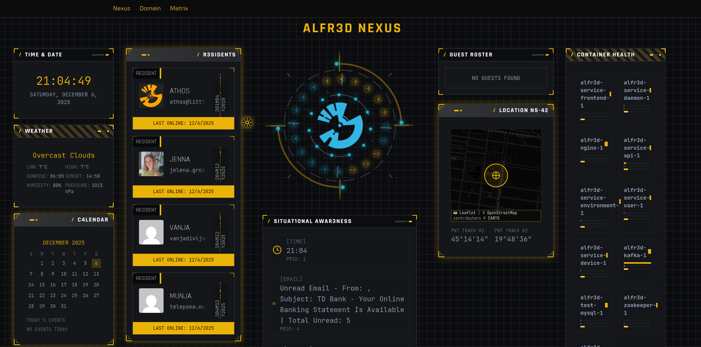
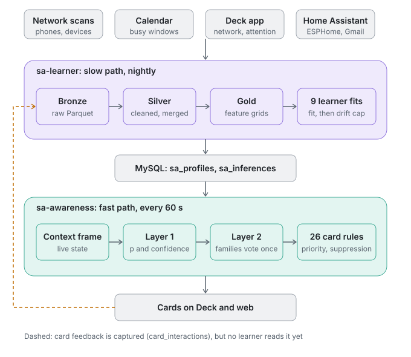

# ALFR3D

A self-hosted home automation platform that behaves like a butler, not a control panel. ALFR3D learns the shape of an ordinary day in your house, notices the one thing that isn't ordinary, and says so once, instead of firing a wall of alerts. It runs entirely on hardware you own.

[](https://github.com/Littl3-1-Engineering/alfr3d/actions/workflows/ci.yml)
[](LICENSE)
[](https://deepwiki.com/Littl3-1-Engineering/alfr3d)

Current release: **v0.5.0 "Learning Curve"** (see [RELEASE_NOTES.md](RELEASE_NOTES.md)).



## What it does

- **Situational awareness.** A rule engine of 26 card types (time, events, leave-by travel, weather and rain advisories, music for gatherings, focus alerts, email, device and disk health, rhythm-break and departure anomalies, and more) shows the few that matter right now. Cards carry structured facts alongside their prose, and dismissing or marking one "not useful" starts a cooldown.
- **Learned baselines.** Nine learners fit nightly on a Parquet history lake (presence, device rhythm, household day type, stay length, time-of-day, rates, scalar series and drift). Each inference carries a probability and a confidence. See [How it learns](#how-it-learns).
- **Routines.** WHEN / IF / THEN automation with time, sunrise/sunset, arrival/departure and device triggers; occupancy, device, temperature and mode conditions; and speak, device, email, thermostat, lock, cover, music and cast actions.
- **Unified device control.** Home Assistant, SmartThings and ESPHome behind one provider-agnostic API. ESPHome is local-only (mDNS discovery, Noise-encrypted native API) and runs alongside whichever of HA or SmartThings is the default.
- **Music.** Spotify playback control, a collaborative-filtering and mood-based recommender that resolves to real playlists, and whole-home casting to Home Assistant speakers.
- **Voice and personality.** Text-to-speech through the `speak` service, a configurable personality matrix with quip categories, optional LLM-generated lines, and time-of-day-aware quiet hours.
- **Cameras.** RTSP streams to the browser as MJPEG or HLS, with snapshots.
- **Dashboards.** A real-time web UI (WebSocket, no polling) with three pages: **Nexus** (live status and cards), **Domain** (people, devices, floorplan) and **Matrix** (routines, personality, integrations, music, themes, system). The Android **Nexus Launcher** is a separate project and exchanges context with the backend (`/api/context/*`).
- **Self-hosted routing.** Leave-by guidance uses a local OSRM engine, so no paid Maps API and no external request per route.

## Architecture

Containerized Python microservices (FastAPI) behind nginx, talking over Kafka, with MySQL as the system of record and Redis as cache. The frontend is React 19 + Vite + Tailwind 4.

| Service | Role |
|---|---|
| `service-api` | REST + WebSocket gateway, auth/RBAC, all `/api/*` routes |
| `service-daemon` | Fast loop engine: schedules, routines, network scans, IoT/calendar/ESPHome sync, mute |
| `sa-awareness` | Situational-awareness fast path: scores learned profiles every 60 s, runs the card rules, publishes cards |
| `sa-learner` | Situational-awareness slow path: nightly Parquet lake build and learner fits (DuckDB + pyarrow) |
| `service-device` | LAN scanning (`arp-scan`) and device state; needs host networking |
| `service-user` | Accounts, presence (online/offline) |
| `service-environment` | Geolocation, weather and forecast, timezone logic |
| `service-speak` | Text-to-speech |
| `service-frontend` | React web app |
| `service-tls` | Run-once local CA and self-healing HTTPS certificate for nginx |
| `nginx` | Reverse proxy on ports 80/443 |
| Infrastructure | Zookeeper, Kafka, MySQL 8, Redis 7 |
| Opt-in | `routing` (OSRM), `migrate` (profile `test`), `service-updater` (profile `tools`), `test-mysql` (profile `test`) |

Kafka topics: `speak`, `user`, `device`, `environment`, `event-stream`, `google`, `situational-awareness`, `integrations`, `personality` (plus `sa-profiles-updated`, which tells `sa-awareness` to reload fitted profiles).

Shared code lives in `services/common/`. The database schema diagram is [`setup/alfr3d_schema.png`](setup/alfr3d_schema.png) (source: [`setup/alfr3d_schema.dbml`](setup/alfr3d_schema.dbml); it covers the core tables, while the situational-awareness tables such as `sa_profiles`, `sa_inferences`, `household_events` and `card_interactions` are defined in the Alembic migrations).

## How it learns



The split is by speed. A slow nightly path (`sa-learner`) copies every source into a bronze Parquet lake, cleans it into silver, shapes gold feature grids, then fits nine learners and writes profiles to MySQL. A fast path (`sa-awareness`) holds those profiles in memory, builds a live context frame every 60 seconds, scores layer-1 inferences, and fuses them in layer 2, where evidence from the same source family counts as one vote so that network, calendar and Deck signals act as independent witnesses. The 26 card rules then read those inferences, apply priority and suppression, and publish to the Deck and web.

The dashed line is the open loop: card feedback is recorded in `card_interactions`, but no learner uses it yet. The plan, phase status and open work are in [`todo/sa/SA_ROADMAP.md`](todo/sa/SA_ROADMAP.md), the entry point for all situational-awareness docs.

## Quick start

Prerequisites: Docker with Compose v2 and BuildKit.

```bash
cp .env.example .env            # then edit credentials; never commit .env
./setup/build_images.sh
docker compose up -d mysql
docker compose exec -T mysql sh -c 'mysql -uroot -p"$MYSQL_ROOT_PASSWORD"' < setup/createTables.sql
docker compose --profile test up migrate    # applies the Alembic chain (setup/migrations)
docker compose up -d
```

Open `http://localhost` (nginx on port 80). On first run, claim a seeded resident account or generate an `owner` account from the sign-in screen.

`service-device` scans the LAN with `arp-scan`, so it runs with host networking. Optional leave-by routing needs a regional dataset first: run `setup/build_routing_extract.sh`, then `docker compose --profile routing up -d routing`.

Integrations (Home Assistant, SmartThings, ESPHome, Spotify, Gmail, Calendar, OpenWeather) are configured from Matrix → Integrations. `setup/authorize_google.py` handles the Google OAuth setup.

## Authentication and secrets

- **Auth.** Every write (`POST`/`PUT`/`DELETE`) needs a bearer token and a role with the right grant; `GET` routes are read-only for anonymous callers. Login returns a short-lived JWT plus a revocable, rotating refresh token, with rate limiting and no username enumeration.
- **Roles.** `owner` (assignable admin), `resident` (everyday household actions), `guest` (read-only), and `technoking` (a non-assignable backdoor role). The matrix is in `services/service_api/auth/permissions.py`.
- **Lockout recovery.** `setup/reset_owner_password.py` resets a password directly against the database, for a solo-owner household with nobody else to reset it.
- **Secrets at rest.** Integration credentials are Fernet-encrypted (`services/common/secrets_utils.py`). The key is generated on first boot into the `secrets_data` volume. **Back up that volume:** if it is lost, every stored credential must be re-entered.
- **Local HTTPS.** `service-tls` creates a private CA once (never regenerated, since a new CA forces every paired Deck to re-pair) and re-issues the nginx certificate when addresses change. The Deck pairs by fetching the public CA from `GET /api/tls/ca`. After moving the box to a new network, run `setup/tls_reissue.sh`.

## Development

```bash
pytest tests/ -m "not integration"            # backend unit tests (as in CI)
pytest tests/                                 # includes MySQL/Kafka integration tests
cd services/service_frontend && npm ci && npm test -- --run && npm run build
./lint.sh                                     # flake8 + black (line length 100) + ESLint
pre-commit install                            # black, flake8, detect-secrets, hygiene hooks
```

- Python 3.14 and Node 24 base images; JSON uses `orjson`; SQL is always parameterized.
- Schema changes go through Alembic (`setup/migrations/versions`, currently up to `0062`). The raw `setup/migration_*.sql` files use their own numbering, so check both before adding one. Take a manual dump before every migration.
- Frontend theme tokens live in `services/service_frontend/src/utils/themes.js`; `themes.css` is generated from it.
- CI (`.github/workflows/ci.yml`) runs frontend lint/test/build, backend unit tests, a clean-MySQL migration check, and integration tests against MySQL and Kafka.
- The API's OpenAPI schema is served by `service-api` on port 5001.

Design intent for the UI ("Neural Blueprint") is in [`ambient_experience.md`](ambient_experience.md). Per-feature plans and history live in [`todo/`](todo/).

## Operations

- **Backups.** `setup/db_backup_daily.sh` writes verified, gzipped dumps (newest 7 kept); install it as a daily cron entry on the host. Restore with `gzip -dc <file> | docker compose exec -T mysql sh -c 'mysql -uroot -p"$MYSQL_ROOT_PASSWORD" "$MYSQL_DATABASE"'`, trying it on `test-mysql` first.
- **Disk.** `sa-learner` samples host disk every 4 hours and raises a `disk_health` card when space runs low; it never deletes anything. Safe pruning, in order: `docker builder prune -f --filter until=24h`, then `docker image prune -f`. Do not run `docker system prune --volumes`; it can remove the `sa_lake`, `secrets_data` and MySQL volumes. `setup/host_usage.sh` (host cron, every 4 hours) feeds the Docker and backup lines of that card. It also records the newest daily DB dump's age: a `backup_health` card goes ambient at 36 h without a fresh `alfr3d_daily_*.sql.gz` and urgent at 96 h (never speaks, never deletes). Nothing to configure; it stays silent until a first daily backup has been seen.
- **Autostart.** Services use `restart: unless-stopped`. For an explicit boot path, install `setup/alfr3d.service` (`sudo cp setup/alfr3d.service /etc/systemd/system/`, point its path at your checkout, then `systemctl enable --now alfr3d.service`).
- **Updates.** `service-updater` backs the in-app "Update Now" flow (see [`todo/todo_selfservice_release_update.md`](todo/todo_selfservice_release_update.md) for status).
- **Kubernetes.** Manifests in `k8s/` (Minikube-oriented) lag Compose: they have no `sa-awareness`, `sa-learner`, `service-tls`, Redis or migration job, and `service-device` runs outside the cluster. Docker Compose is the supported deployment path.

## Credits

The animated HUD rings are original React/Framer Motion recreations of [Goran Spasojevic](https://codepen.io/gorango)'s ["cyber btns"](https://codepen.io/gorango/pen/vNXejK) pen, with his [Cyber Dial](https://codepen.io/gorango/pen/bVBWmr) and [SVG Glitch](https://codepen.io/gorango/pen/GpYBqY) pens as design references.

## License

[Functional Source License, Version 1.1, ALv2 Future License](LICENSE) (FSL-1.1-ALv2). Free to self-host, modify and read; the software may not be used to offer a competing commercial product or service. Each version converts to Apache 2.0 two years after its release.
